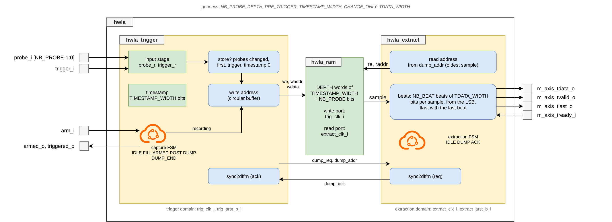
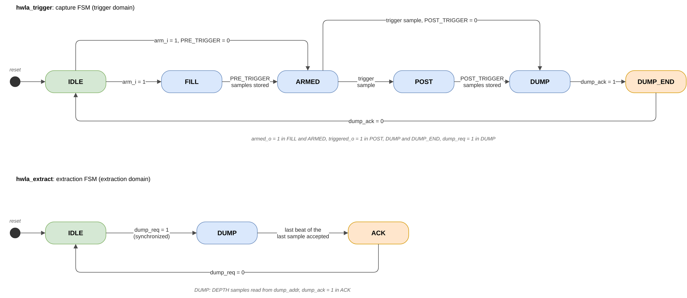
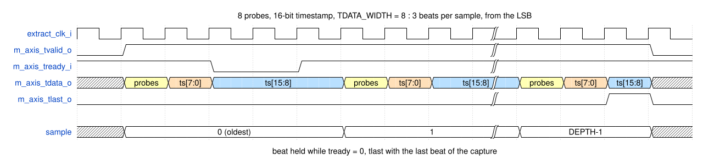

<!--
  README MODEL (common to every Asylum IP, keep the same headings)
  ----------------------------------------------------------------
  Regenerate from the sources, never from the previous README text alone:
    hdl/*.vhd (entities, generics, ports), hdl/csr/*.hjson (register map),
    <IP>.core (VLNV, targets, depends), mk/targets.txt, sim/, syn/, esw/.
  Sections, in this order:
    badges / title + one-line pitch / Overview / Features / Block Diagram /
    Getting Started / Hardware Interfaces / Configuration / Resources /
    Theory of Operation / Registers / Programmer's Guide /
    Design Verification / Dependencies and Related IPs / License
  Rules:
    - English, short and factual: every statement backed by the sources.
    - No VLNV line: the version badge shows it.
    - Badges: first line version, license; second line CI, lint, sim, syn.
    - Block diagram and FSM: pages Overview and FSM of doc/<NAME>.drawio, exported to
      doc/<NAME>-Overview.png and doc/<NAME>-FSM.png (make -C doc).
    - Timing diagrams: WaveDrom source doc/<NAME>-<what>.json, rendered
      doc/<NAME>-<what>.svg (make -C doc), shown as images.
    - No CPU named (OpenBlaze, PicoBlaze, RISC-V) outside the CPU and SoC IPs.
    - Registers: link to the generated hdl/csr/<X>_csr.md, never copy the tables.
    - Tables: Configuration = Name|Type|Default|Description,
      Hardware Interfaces = Name|Direction|Type|Description, grouped by interface.
    - A section with nothing to say is one line ("This IP has no
      software-visible registers."), never removed.
-->
[](https://github.com/deuskane/asylum-debug-hwla/tags)
[](LICENSE)

[](https://github.com/deuskane/asylum-debug-hwla/actions/workflows/ci.yml)
[](https://github.com/deuskane/asylum-debug-hwla/actions/workflows/ci.yml)
[](https://github.com/deuskane/asylum-debug-hwla/actions/workflows/ci.yml)
[](https://github.com/deuskane/asylum-debug-hwla/actions/workflows/ci.yml)

# Hardware Logic Analyzer (HWLA)

**A small, readable embedded logic analyzer in VHDL: probes and a trigger captured in the clock domain of the design, captures sent on an AXI-Stream master in another clock domain, optional timestamp and storage of the changes only.**

Part of the [Asylum project](https://github.com/deuskane/asylum-project), a collection of small IP cores, written to be read and learned from.

## Table of Contents

1. [Overview](#overview)
2. [Features](#features)
3. [Block Diagram](#block-diagram)
4. [Getting Started](#getting-started)
5. [Hardware Interfaces](#hardware-interfaces)
6. [Configuration](#configuration)
7. [Resources](#resources)
8. [Theory of Operation](#theory-of-operation)
9. [Registers](#registers)
10. [Programmer's Guide](#programmers-guide)
11. [Design Verification](#design-verification)
12. [Dependencies and Related IPs](#dependencies-and-related-ips)
13. [License](#license)

## Overview

The HWLA watches signals inside an FPGA design, like a logic analyzer on a bench. At each rising edge of the trigger clock it samples the probes (`probe_i`, `NB_PROBE` bits: its width is the number of probes) and one trigger, stores a capture of `DEPTH` samples around the trigger (`PRE_TRIGGER` samples before the trigger sample) in a RAM, then sends the capture on an AXI-Stream master clocked by another clock, for example to a UART transmitter. [tools/hwla2vcd.py](tools/hwla2vcd.py) rebuilds a VCD file from the received bytes, to be viewed with GTKWave.

It has no register: the configuration is made of generics, a capture is started with the `arm_i` input and `armed_o` / `triggered_o` give its progress. A stored sample is a timestamp and the probes; with `CHANGE_ONLY = true` a sample is stored only when the probes change, so a capture covers much more than `DEPTH` clock cycles.

## Features

- Two clock domains: trigger part (`trig_clk_i`, the clock of the probed design) and extraction part (`extract_clk_i`), a simple dual port RAM with one clock per port between them, a 4-phase req/ack handshake with `sync2dffrn` synchronizers
- Probes and trigger registered together: the trigger flag of a sample is always the one of its probes
- `PRE_TRIGGER` stored samples before the trigger sample, `DEPTH - 1 - PRE_TRIGGER` after (0 to `DEPTH - 1` pre-trigger samples); the trigger is ignored until the pre-trigger samples are stored, so the trigger sample is always the sample number `PRE_TRIGGER` of the capture
- Single capture (pulse on `arm_i`) or continuous captures (`arm_i` held high: a new capture after each extraction)
- Timestamp of each stored sample (`TIMESTAMP_WIDTH` bits, 0 = no timestamp)
- `CHANGE_ONLY = true`: a sample is stored only if the probes changed, and also for the first sample of a capture, for the trigger sample and when the timestamp is 0, so the time between two stored samples is always given by their timestamps
- AXI-Stream master: one sample per beat (`TDATA_WIDTH = 0`, `tdata` rounded up to bytes) or `NB_BEAT` beats of `TDATA_WIDTH` bits per sample, from the LSB; `tlast` on the last beat of the capture; one beat per clock cycle, back pressure supported
- No capture is started while the previous one is not extracted: the RAM is never written and read at the same time
- [tools/hwla2vcd.py](tools/hwla2vcd.py): VCD files rebuilt from the byte stream (file or serial port); copied to `hwla/hwla2vcd.py` in the build directory of every target that uses this core (fileset `tools` of the default target), e.g. next to the bitstream of a design that instantiates the HWLA

## Block Diagram



- `hwla_trigger` ([hdl/hwla_trigger.vhd](hdl/hwla_trigger.vhd)), trigger domain: the input stage registers `probe_i` and `trigger_i`, the timestamp counts the clock cycles, the store logic decides if the sample of the input stage is written in the RAM, the capture FSM handles `arm_i`, the pre / post-trigger samples and the request to the extraction domain; the write address wraps around the RAM (circular buffer).
- `hwla_ram` ([hdl/hwla_ram.vhd](hdl/hwla_ram.vhd)): `DEPTH` words of `TIMESTAMP_WIDTH + NB_PROBE` bits, write port in the trigger domain, synchronous read port in the extraction domain, no reset.
- `hwla_extract` ([hdl/hwla_extract.vhd](hdl/hwla_extract.vhd)), extraction domain: on the synchronized request, the extraction FSM reads the `DEPTH` samples from the oldest one (`dump_addr`), the beat logic sends each sample in `NB_BEAT` beats; at the end of the capture, the acknowledge goes back to the trigger domain.

## Getting Started

The cores of the Asylum IPs are published in the FuseSoC library [asylum-cores](https://github.com/deuskane/asylum-cores) (with the UVVM core used by the testbenches):

```bash
pip install fusesoc
fusesoc library add https://github.com/deuskane/asylum-cores
fusesoc run --target sim_basic_capture asylum:debug:HWLA  # needs GHDL
```

To use the IP in your design, add `asylum:debug:HWLA` to the `depend` list of your core and instantiate `hwla` (library `asylum`). Example: 8 probes, 1024 samples, 16-bit timestamp, captures sent byte per byte to `uart_tx_axis` of [asylum-communication-uart](https://github.com/deuskane/asylum-communication-uart) (as in [sim/uart/tb_hwla_uart.vhd](sim/uart/tb_hwla_uart.vhd)):

```vhdl
library asylum;
use     asylum.hwla_pkg.all;

  ins_hwla : hwla
    generic map
    ( DEPTH            => 1024
     ,PRE_TRIGGER      => 256
     ,TIMESTAMP_WIDTH  => 16
     ,CHANGE_ONLY      => true
     ,TDATA_WIDTH      => 8
    )
    port map
    ( trig_clk_i       => clk_design
     ,trig_arst_b_i    => arst_b_design
     ,arm_i            => '1'               -- continuous captures
     ,trigger_i        => my_trigger
     ,probe_i          => my_probes         -- std_logic_vector(8-1 downto 0) : 8 probes
     ,armed_o          => led_armed
     ,triggered_o      => led_triggered
     ,extract_clk_i    => clk_uart
     ,extract_arst_b_i => arst_b_uart
     ,m_axis_tdata_o   => uart_tdata        -- std_logic_vector(8-1 downto 0) : TDATA_WIDTH bits
     ,m_axis_tvalid_o  => uart_tvalid
     ,m_axis_tready_i  => uart_tready
     ,m_axis_tlast_o   => open
    );
```

`probe_i` and `m_axis_tdata_o` are unconstrained: the number of probes `NB_PROBE` is the width of the actual of `probe_i` (a signal of any range, or in VHDL-2008 an expression such as a concatenation `a & b`, whose rightmost bit is the probe 0). The actual of `m_axis_tdata_o` must be `hwla_tdata_width(hwla_sample_width(NB_PROBE, TIMESTAMP_WIDTH), TDATA_WIDTH)` bits: `TDATA_WIDTH` bits, or with `TDATA_WIDTH = 0` the sample (`NB_PROBE + TIMESTAMP_WIDTH` bits) rounded up to a multiple of 8. Another width is a length error at elaboration (simulation and synthesis).

Then on the host (8 probes, 1024 samples, 256 pre-trigger samples, 16-bit timestamp, 8-bit beats, trigger clock of 20 ns):

```bash
python3 tools/hwla2vcd.py --port /dev/ttyUSB0 --baudrate 115200 --captures 1 -n 8 -d 1024 -p 256 -t 16 -w 8 --period 20 -o capture.vcd
gtkwave capture.vcd
```

## Hardware Interfaces

Top-level entity: **`hwla`** ([hdl/hwla.vhd](hdl/hwla.vhd)), component in `asylum.hwla_pkg`.

### Trigger domain

| Name | Direction | Type | Description |
|------|-----------|------|-------------|
| `trig_clk_i` | in | std_logic | Trigger clock: the probes are sampled at each rising edge |
| `trig_arst_b_i` | in | std_logic | Asynchronous reset of the trigger domain, active low |
| `arm_i` | in | std_logic | 1: start a capture (taken into account when the HWLA is idle). Pulse: one capture; held high: a new capture after each extraction |
| `trigger_i` | in | std_logic | Trigger condition, active high (level) |
| `probe_i` | in | std_logic_vector (unconstrained) | Probed signals, synchronous to `trig_clk_i`; its width is the number of probes `NB_PROBE`, its rightmost bit is the probe 0 (any range) |
| `armed_o` | out | std_logic | 1: capture started, trigger not yet seen (pre-trigger samples, then wait for the trigger) |
| `triggered_o` | out | std_logic | 1: trigger seen, capture not yet extracted (post-trigger samples, extraction) |

### Extraction domain (AXI-Stream master)

| Name | Direction | Type | Description |
|------|-----------|------|-------------|
| `extract_clk_i` | in | std_logic | Extraction clock (AXI-Stream clock) |
| `extract_arst_b_i` | in | std_logic | Asynchronous reset of the extraction domain, active low |
| `m_axis_tdata_o` | out | std_logic_vector (unconstrained) | Beat of a sample; the caller gives exactly `hwla_tdata_width(hwla_sample_width(NB_PROBE, TIMESTAMP_WIDTH), TDATA_WIDTH)` bits (see [Getting Started](#getting-started) and [Stream format](#stream-format)) |
| `m_axis_tvalid_o` | out | std_logic | Beat valid |
| `m_axis_tready_i` | in | std_logic | Beat accepted by the slave |
| `m_axis_tlast_o` | out | std_logic | Last beat of the capture |

The two resets are asynchronous and should be asserted together: a reset of one domain alone during a handshake is not supported.

## Configuration

Generics of `hwla`:

| Name | Type | Default | Description |
|------|------|---------|-------------|
| `DEPTH` | positive | `256` | Number of stored samples of a capture: depth of the RAM, a power of 2, at least 2 |
| `PRE_TRIGGER` | natural | `128` | Number of stored samples before the trigger sample (0 to `DEPTH - 1`) |
| `TIMESTAMP_WIDTH` | natural | `16` | Width of the timestamp of a sample (0: no timestamp) |
| `CHANGE_ONLY` | boolean | `true` | `true`: a sample is stored only if the probes changed (and for the first sample, the trigger sample and the timestamp 0); `false`: every sample is stored |
| `TDATA_WIDTH` | natural | `0` | Width of `m_axis_tdata_o` (multiple of 8); 0: one beat per sample, `tdata` is the sample rounded up to an integer number of bytes |

The number of probes `NB_PROBE` is not a generic: it is the width of `probe_i` (`probe_i'length`).

Derived values (functions of `asylum.hwla_pkg`): sample width `hwla_sample_width = NB_PROBE + TIMESTAMP_WIDTH`, `tdata` width `hwla_tdata_width(sample width, TDATA_WIDTH)`, beats per sample `hwla_nb_beat(sample width, TDATA_WIDTH)`. The RAM (`DEPTH` x sample width bits) sets most of the area.

## Resources

Figures of the `syn_*` targets (`make nonreg_syn`, see [Targets](#targets)): [syn/hwla_wrapper.vhd](syn/hwla_wrapper.vhd) with the generics of each configuration (its generic `NB_PROBE` sizes `probe_i`), synthesized by Yosys and its GHDL plugin; the reports are in the build directory of each target. Configurations as `NB_PROBE` / `DEPTH` / `TIMESTAMP_WIDTH`, so a RAM of `DEPTH` words of `NB_PROBE + TIMESTAMP_WIDTH` bits.

| Configuration | LUT¹ | LUTRAM¹ | FF¹ | CARRY4¹ | MUXF7/F8¹ | BRAM¹ | DSP¹ | Area² (µm²) | kGE³ |
|---|---|---|---|---|---|---|---|---|---|
| `syn_default` (8 / 256 / 16, 128 pre-trigger samples, changes only) | 73 | 0 | 80 | 12 | 15 | 0.5 | 0 | 243453.49 | 64.859 |
| `syn_pre_trigger_0` (8 / 256 / 16, no pre-trigger sample) | 79 | 0 | 80 | 12 | 4 | 0.5 | 0 | 241343.97 | 64.297 |
| `syn_pre_trigger_max` (8 / 256 / 16, no post-trigger sample) | 73 | 0 | 80 | 12 | 0 | 0.5 | 0 | 243499.79 | 64.871 |
| `syn_all_samples` (8 / 256 / 0, every sample stored) | 73 | 48 | 63 | 8 | 3 | 0 | 0 | 83382.47 | 22.214 |
| `syn_uart` (8 / 256 / 16, 3 beats of 8 bits) | 86 | 0 | 82 | 12 | 15 | 0.5 | 0 | 241943.29 | 64.456 |
| `syn_min` (1 / 2 / 0, every sample stored) | 29 | 0 | 23 | 0 | 3 | 0 | 0 | 972.18 | 0.259 |

¹ Xilinx Artix-7 (LUT6), Yosys 0.33 `synth_xilinx -flatten -noiopad -noclkbuf`, before place and route: every cell of the netlist is counted, Vivado may differ. Identical cells are merged as a vendor tool does (`opt_merge -share_all`): the inverters of an active-low reset net become one; every remaining cell is counted, an `INV` as a `LUT1`. Where the capture RAM goes: one `RAMB18E1` (half a 36 Kb block, BRAM 0.5) for 256 x 24 bits, 12 `RAM64M` (48 LUTRAM) for the 256 x 8 bits of `syn_all_samples`, flip-flops for the 2 x 1 bit of `syn_min`.

² SkyWater sky130 `sky130_fd_sc_hd`, typical corner (tt, 25 °C, 1.80 V), Yosys 0.33 `synth` + `dfflibmap` + `abc -liberty`: standard-cell area only, no timing constraint, no buffering, clock tree or placement. There is no SRAM macro: the capture RAM becomes `DEPTH x (NB_PROBE + TIMESTAMP_WIDTH)` flip-flops and their read multiplexer, most of the area; a real ASIC would use an SRAM macro.

³ Area in thousands of NAND2 gate equivalents (`sky130_fd_sc_hd__nand2_1` = 3.7536 µm²).

## Theory of Operation

### Capture



Capture FSM of `hwla_trigger`:

- `IDLE`: nothing is recorded. When `arm_i = 1`, the capture starts with the sample of this rising edge (`armed_o` rises just after it).
- `FILL`: the `PRE_TRIGGER` first stored samples; the trigger is ignored (skipped when `PRE_TRIGGER = 0`).
- `ARMED`: the samples are stored in the circular buffer until the trigger: the first sample with `trigger_i = 1` is the trigger sample. `triggered_o` rises one clock cycle after the rising edge that sampled it.
- `POST`: the `DEPTH - 1 - PRE_TRIGGER` stored samples after the trigger sample (skipped when this number is 0).
- `DUMP`, `DUMP_END`: request to the extraction domain, wait for the acknowledge and for its fall (4-phase handshake), then `IDLE`. `arm_i` and the trigger are ignored until `IDLE`.

At the end of the capture the write address is the address of the oldest sample: it is sent with the request (`dump_addr`). The extraction FSM of `hwla_extract` waits for the synchronized request (`IDLE`), reads the `DEPTH` samples from `dump_addr` (`DUMP`), then sets the acknowledge until the request falls (`ACK`).

The trigger is a level: tie `trigger_i` to a combination of the probes, or to an edge detector of the user design. With a trigger already high when the capture starts, the trigger sample is the first sample after the pre-trigger samples.

### Stored samples

With `CHANGE_ONLY = false`, every sample is stored: a capture is `DEPTH` consecutive clock cycles. With `CHANGE_ONLY = true`, a sample is stored when:

- its probes are different from the last stored sample,
- it is the first sample of the capture (initial value of the probes),
- it is the trigger sample (even without change),
- its timestamp is 0 (`TIMESTAMP_WIDTH > 0`): at least one stored sample every `2**TIMESTAMP_WIDTH` clock cycles.

The timestamp is the number of clock cycles since the reset, modulo `2**TIMESTAMP_WIDTH` (the sample of the first rising edge after the reset has the timestamp 0). The number of clock cycles between two consecutive stored samples is the difference of their timestamps modulo `2**TIMESTAMP_WIDTH`, where 0 means `2**TIMESTAMP_WIDTH`. With very quiet probes, the pre-trigger and post-trigger parts take up to `2**TIMESTAMP_WIDTH` clock cycles per stored sample; `CHANGE_ONLY = true` without timestamp loses the time between the stored samples.

### Stream format

The captures are sent one after the other, a capture is `DEPTH` samples from the oldest one; the trigger sample is the sample number `PRE_TRIGGER`. A sample is `{timestamp, probes}` (probes on the `NB_PROBE` LSB), padded with 0 to `NB_BEAT x tdata width` bits, and sent in `NB_BEAT` beats from the LSB. `tlast` is set with the last beat of the capture. Example with 8 probes, a 16-bit timestamp and `TDATA_WIDTH = 8`: 3 bytes per sample, `probes`, `timestamp(7:0)`, `timestamp(15:8)`.



The first beat of a capture is sent a few clock cycles of `extract_clk_i` after the end of the capture (synchronization of the request), then one beat per clock cycle while `m_axis_tready_i = 1`; a beat is held while `m_axis_tready_i = 0`. The RAM output register holds the sample: the next sample is read when the last beat of the current one is accepted.

### Clock domain crossings

- `sync2dffrn` ([asylum-target-techmap](https://github.com/deuskane/asylum-target-techmap)): 2-flip-flop synchronizers of `dump_req` (to the extraction domain) and `dump_ack` (to the trigger domain), with the `ASYNC_REG` attribute;
- `dump_addr` (trigger domain register, read by the extraction domain) is quasi-static: stable from the rise of `dump_req` to the fall of `dump_ack`; constrain it with a max delay (one period of `extract_clk_i`) or a false path;
- the RAM is written by the trigger domain and read by the extraction domain, never at the same time (a block RAM needs no constraint; a distributed RAM, whose read is asynchronous, needs the same constraint as `dump_addr`).

### VCD file (tools/hwla2vcd.py)

[tools/hwla2vcd.py](tools/hwla2vcd.py) (Python 3, no dependency; `pyserial` for `--port`) rebuilds one VCD file per capture from the byte stream: time 0 is the first sample of the capture, the probes (one wire per probe, one bus with `--bus`, or named signals with `--signal`) and a `trigger` wire, high during the clock cycle of the trigger sample. Its parameters are the generics of the HWLA and the period of the trigger clock.

```bash
# Bytes received on a UART and saved in a file (Linux)
stty -F /dev/ttyUSB0 115200 raw -echo
cat /dev/ttyUSB0 > capture.bin
python3 tools/hwla2vcd.py capture.bin -n 8 -d 1024 -p 256 -t 16 -w 8 --period 20 --names valid,ready,d0,d1,d2,d3,d4,d5 -o capture.vcd
```

`--format hex` reads a text file of hexadecimal bytes (as written by `tb_hwla_uart`), `--capture N` writes only the capture `N`. With several captures, the files are `<output>_<n>.vcd`. `--args-file FILE` (or `@FILE`) reads the arguments from a file, one per line, as `tb_hwla_uart` writes them in `hwla2vcd.args`; with `--args-file`, empty lines and lines starting with `#` are ignored.

Named signals: `--signal NAME=MSB[:LSB]` (repeated) dumps the probes `MSB` downto `LSB` as the vector `NAME`, or the probe `MSB` as the wire `NAME`; with `--signal`, only the named signals and `trigger` are in the VCD. The configuration of the HWLA of a design and the names of its probes fit in one file:

```bash
# probes.args : one argument per line
-n
8
-d
1024
-p
256
--period
20
--signal=valid=0
--signal=ready=1
--signal=data=7:2
```

```bash
python3 tools/hwla2vcd.py capture.bin --args-file probes.args -o capture.vcd
```

Several captures in one VCD file: `--merge` places each capture after the previous one from their timestamps and puts the probes at `x` (gray in GTKWave) between two captures; a `capture` variable gives the number of the capture. The timestamp counts the clock cycles since the reset modulo `2**TIMESTAMP_WIDTH`: the distance shown is the real one modulo `2**TIMESTAMP_WIDTH` clock cycles (a longer pause between two captures is shown shorter). `--gap N` forces a distance of `N` clock cycles between the last sample of a capture and the first one of the next (default without timestamp: 16).

```bash
python3 tools/hwla2vcd.py capture.bin --args-file probes.args --merge -o captures.vcd
```

## Registers

This IP has no software-visible registers: the configuration is made of generics, the control and the status are the ports `arm_i`, `armed_o` and `triggered_o`.

## Programmer's Guide

This IP has no software-visible registers: the captures are read on the host with [tools/hwla2vcd.py](tools/hwla2vcd.py) (see [VCD file](#vcd-file-toolshwla2vcdpy)).

## Design Verification

### Testbenches

| File | DUT | Description |
|------|-----|-------------|
| [sim/basic/tb_hwla.vhd](sim/basic/tb_hwla.vhd) | `hwla` | Self-checking UVVM testbench, two asynchronous clocks, generics `TESTS_LIST` (scenarios, see below), the generics of the HWLA and the periods of the two clocks. The captures are received with the UVVM AXI-Stream BFM. A history records the probes and the trigger of each sample as sampled by the HWLA, and a model computes from it the samples stored by each capture (store rules, pre / post-trigger samples, trigger sample): every received sample is checked against the timestamp and the probes of its expected sample. Monitors: first sample of each capture (rise of `armed_o`), AXI-Stream protocol (`tvalid`, `tdata`, `tlast` held while `tready = 0`, `tlast` only with `tvalid`, `DEPTH x NB_BEAT` beats per capture). Probes: COUNT (a change at each sample), SPARSE (a change every 4 samples on average), FROZEN, FORCE. The scenarios drive the bench and read its monitors through the records `tb_req` / `tb_rsp`. One package per scenario (`tb_hwla_<name>_pkg`), names, applicability and dispatch in [tb_hwla_tests_pkg](sim/basic/tb_hwla_tests_pkg.vhd), helpers (configuration, history, model, capture, reset pulse of both domains) in [tb_hwla_bfm_pkg](sim/basic/tb_hwla_bfm_pkg.vhd) |
| [sim/uart/tb_hwla_uart.vhd](sim/uart/tb_hwla_uart.vhd) | `hwla` + `uart_tx_axis` | The HWLA (`TDATA_WIDTH = 8`) connected to `uart_baud_rate_gen` and `uart_tx_axis` of asylum-communication-uart (no CSR). 8 probes (counter, toggle, pulse, slow value), trigger on a value of the probes, 2 continuous captures. The UART line is received with the UVVM UART BFM, each byte is checked against the AXI-Stream beat and written in `hwla_uart.hex`; the testbench also writes the reference `hwla_uart_ref.txt` (changes of the probes, trigger samples) and the arguments of the scripts (`hwla2vcd.args`, `check_vcd.args`). The `post_run` hooks rebuild the VCD files with `tools/hwla2vcd.py` and check them sample by sample with [sim/uart/check_vcd.py](sim/uart/check_vcd.py). A single scenario: no `TESTS_LIST` |

### Scenarios (`TESTS_LIST`)

The scenarios of `tb_hwla` are chosen at run time with the generic `TESTS_LIST`: names separated by `,` without space (`capture,async_reset,capture`), a name may be repeated. The sequencer first checks every name (an unknown name, or a scenario that does not apply to the generics, is a `TB_ERROR` before any scenario runs), then for each scenario puts the stimuli back to idle, drives a reset pulse of both domains, logs `TEST <i>/<N> : <name>` and runs it: each scenario starts from reset. The empty list (default) only compiles and elaborates the testbench. The list is parsed with `list_length` / `list_item` / `list_contains` of `asylum.string_pkg` (`asylum:utils:pkg` >= 1.10.0).

Checks counted as the `=> OK` lines of the log, configuration `basic`; the sample by sample comparison of each capture (`DEPTH` checks) and the AXI-Stream protocol monitor are silent (`ID_NEVER`), not counted.

| Name | Checks | Applies to | Description |
|------|--------|------------|-------------|
| `reset_values` | 4 | all | Outputs after the reset |
| `not_armed` | 3 | all | Trigger pulse without `arm_i`: no capture, no beat |
| `capture` | 12 | all | Single capture, trigger 7 samples after the pre-trigger samples |
| `pre_trigger_ignored` | 12 | `PRE_TRIGGER >= 3` | Triggers during the pre-trigger samples ignored: the last pre-trigger sample is ignored, the next one is the trigger sample |
| `level_trigger` | 12 | all | Level trigger already high at the arm: the trigger sample is the first sample after the pre-trigger samples |
| `late_trigger` | 14 | all | Trigger after 3 turns of the circular buffer |
| `back_pressure` | 12 | all | Random back pressure (`tready` low before random beats) |
| `stall` | 18 | all | Long stall: beat held, `arm_i` and the trigger ignored until the end of the extraction, no capture afterwards |
| `continuous` | 28 | all | 3 continuous captures with `arm_i` held high, no capture after `arm_i` low |
| `sparse` | 22 | all | Sparse probes, 2 captures with a level trigger: often a trigger sample without change |
| `frozen` | 11 (other configurations) | `2**TIMESTAMP_WIDTH <= 64` or `CHANGE_ONLY = false` | Frozen probes: samples stored at the timestamp 0 only |
| `first_sample` | 22 | `PRE_TRIGGER > 0` | First sample of a capture equal to the last stored sample of the previous capture: stored anyway |
| `async_reset` | 22 | all | Asynchronous reset of both domains during an extraction: outputs low without clock edge, capture lost, then a new capture (new origin of the timestamp) |

Configurations (generics of the targets; `NB_PROBE` of `tb_hwla` sizes the probes given to `hwla`):

| Configuration | NB_PROBE | DEPTH | PRE_TRIGGER | TIMESTAMP_WIDTH | CHANGE_ONLY | TDATA_WIDTH | Trigger / extraction clock | Checks |
|---------------|----------|-------|-------------|-----------------|-------------|-------------|----------------------------|--------|
| `basic` (reference) | 12 | 32 | 10 | 16 | true | 0 (one 32-bit beat) | 10 ns / 18 ns | 181 (12 scenarios, no `frozen`) |
| `pre_trigger_0` | 8 | 16 | 0 | 8 | true | 8 (2 beats) | 26 ns / 8 ns | 147 (10 scenarios) |
| `pre_trigger_max` | 33 | 64 | 63 (no post-trigger sample) | 4 (frequent wraps) | true | 16 (3 beats) | 6 ns / 34 ns | 192 (13 scenarios) |
| `same_period` | 16 | 128 | 64 | 0 | false | 0 (one 16-bit beat) | 10 ns / 10 ns | 192 (13 scenarios) |
| `all_samples` | 8 | 32 | 16 | 16 | false | 32 (padding in the beat) | 14 ns / 10 ns | 192 (13 scenarios) |
| `min` | 1 | 2 | 1 | 0 | false | 0 (one 8-bit beat) | 10 ns / 100 ns (handshake longer than a capture) | 180 (12 scenarios) |

### Targets

| Target | Toplevel | Description |
|--------|----------|-------------|
| `default` | `hwla` | HDL fileset (not a simulation) |
| `sim_basic` | `tb_hwla` | Reference configuration `basic`: build and elaboration only (`TESTS_LIST` empty), base of the scenario targets and of the list runs |
| `sim_basic_<name>` | `tb_hwla` | One target per scenario of the configuration `basic`: `sim_basic_reset_values`, `_not_armed`, `_capture`, `_pre_trigger_ignored`, `_level_trigger`, `_late_trigger`, `_back_pressure`, `_stall`, `_continuous`, `_sparse`, `_first_sample`, `_async_reset` (181 checks in all) |
| `sim_pre_trigger_0`, `sim_pre_trigger_max`, `sim_same_period`, `sim_all_samples`, `sim_min` | `tb_hwla` | The other configurations, every scenario that applies |
| `sim_uart` | `tb_hwla_uart` | HWLA on `uart_tx_axis`, 32 samples, 8 pre-trigger samples, 16-bit timestamp, changes only (3 bytes per sample), then VCD rebuilt and checked (`post_run` hooks), 5 checks |
| `sim_uart_no_timestamp` | `tb_hwla_uart` | Same, 64 samples, 16 pre-trigger samples, no timestamp, every sample stored (1 byte per sample), 5 checks |
| `lint_ghdl` | `asylum.hwla_wrapper` | GHDL `-Wall` analysis and elaboration of [syn/hwla_wrapper.vhd](syn/hwla_wrapper.vhd) |
| `lint_ghdl_synth_<config>` | `asylum.hwla_wrapper` | `ghdl --synth` check (no latch, synthesizable) for 6 generic configurations: `default`, `pre_trigger_0`, `pre_trigger_max`, `all_samples`, `uart`, `min` |
| `syn_<config>` | `asylum.hwla_wrapper` | Synthesis with Yosys, Artix-7 and sky130 (see [Resources](#resources)), same 6 configurations as `lint_ghdl_synth_<config>` |

The reference configuration of a testbench has a build-only base target and one target per scenario: one CI job per scenario, a failure is isolated. Every other configuration has one target that runs its whole list: the `TEST <i>/<N>` header names a failing scenario. FuseSoC replaces the `parameters` list of an inherited target, so each target repeats the generics of its configuration.

Every `sim_*`, `lint_*` and `syn_*` target is a job of the [GitHub CI](https://github.com/deuskane/asylum-debug-hwla/actions/workflows/ci.yml), run in the [asylum-env](https://github.com/deuskane/asylum-ci) image (GHDL, FuseSoC, UVVM, Yosys). The `sim`, `lint` and `syn` badges count the passed and failed targets of the last run on `main`.

### How to Run

From a clone of [asylum-project](https://github.com/deuskane/asylum-project) (GHDL and FuseSoC installed, or in the asylum-env image):

```bash
make help                        # variables, rules and targets
make sim_basic_capture           # one scenario, log in log/
make sim_pre_trigger_max         # every scenario of a configuration
make nonreg_sim                  # every sim_* target
make nonreg_lint                 # every lint_* target
make nonreg_syn                  # every syn_* target (Yosys, figures of Resources)
make TARGETS_FILTER=^sim_basic_ nonreg_sim
```

To run a list of scenarios, build the testbench once, then run the list without recompiling, with FuseSoC (same `--build-root` and `--no-export` as the Makefile, so that the build of the target is reused; any generic of the target can be overridden after the VLNV):

```bash
make sim_basic                   # build and elaboration (TESTS_LIST empty)
fusesoc --cores-root . run --build-root build --no-export --run --target sim_basic asylum:debug:HWLA:3.0.0 --TESTS_LIST=capture,async_reset,capture
```

or in the build directory of the target. `EXTRA_OPTIONS` replaces every generic set by the target: repeat the generics of the configuration, else their default values (`basic`) apply:

```bash
cd build/asylum_debug_HWLA_3.0.0/sim_basic-ghdl
make run EXTRA_OPTIONS="-gTESTS_LIST=frozen,capture -gNB_PROBE=8 -gDEPTH=32 -gPRE_TRIGGER=16 -gTIMESTAMP_WIDTH=16 -gCHANGE_ONLY=false -gTDATA_WIDTH=32 -gTRIG_CLK_PERIOD=14 -gEXTRACT_CLK_PERIOD=10"
```

To add a scenario: a package `tb_hwla_<name>_pkg` with a procedure `run` (in the `sim_basic` fileset), its name in `C_TESTS` (and in `test_applies` if it does not apply to every configuration) and its case in `run_test` of [tb_hwla_tests_pkg](sim/basic/tb_hwla_tests_pkg.vhd), a `sim_basic_<name>` target and the name in the `TESTS_LIST` of the other configurations in [HWLA.core](HWLA.core), then `make mk/targets.txt` and `make ci_generate`.

Outside the CI, GHDL writes a waveform `dut.fst`. `sim_uart*` also leave `hwla_uart.hex`, `hwla_uart_ref.txt`, `hwla2vcd.args`, `check_vcd.args` and the rebuilt `hwla_uart_0.vcd`, `hwla_uart_1.vcd` in their build directory.

## Dependencies and Related IPs

| Core | Repository | Purpose |
|------|------------|---------|
| `asylum:utils:pkg` | [asylum-utils-pkg](https://github.com/deuskane/asylum-utils-pkg) | Common packages (`math_pkg`: `log2`, `is_pow2`); the testbench needs >= 1.10.0 (`string_pkg` lists of `TESTS_LIST`) |
| `asylum:target:techmap` | [asylum-target-techmap](https://github.com/deuskane/asylum-target-techmap) | `sync2dffrn` synchronizers |
| `asylum:utils:ghdl_synth` | [asylum-utils-generators](https://github.com/deuskane/asylum-utils-generators) | `ghdl --synth` check of the `lint_ghdl_synth_*` targets |
| `asylum:utils:yosys_synth` | [asylum-utils-generators](https://github.com/deuskane/asylum-utils-generators) | Yosys synthesis of the `syn_*` targets (Artix-7 and sky130) |
| `asylum:communication:uart` | [asylum-communication-uart](https://github.com/deuskane/asylum-communication-uart) | `uart_tx_axis` and `uart_baud_rate_gen` of `tb_hwla_uart` (testbench only) |
| `bitvis:verification:uvvm` | [UVVM](https://github.com/UVVM/UVVM) | Verification library, AXI-Stream and UART VIPs (testbenches only) |

Other Asylum IPs with an AXI-Stream or a UART: [UART](https://github.com/deuskane/asylum-communication-uart). All the IPs: [asylum-project](https://github.com/deuskane/asylum-project).

## License

Apache License 2.0, see [LICENSE](LICENSE).
